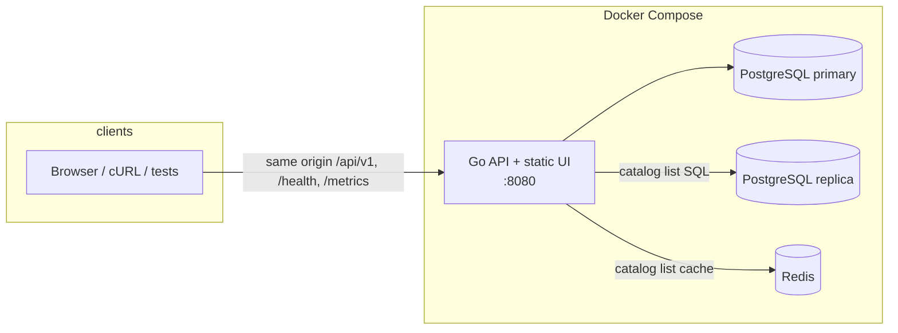
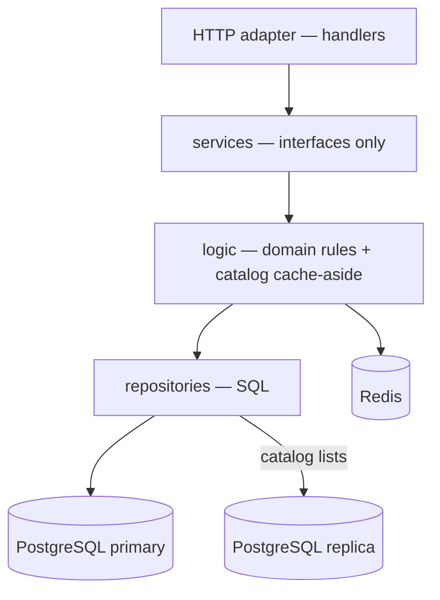

# System Design Document

**Scenario:** Dealership vehicle inventory dashboard — managers filter vehicles, identify **aging stock** (in stock more than 90 days), and record a **proposed action**.

**Chosen service layer:** Backend (REST API + persistent PostgreSQL). A React UI is included as a live client against the same API; acceptance criteria for this assessment are fulfilled and verified through the API and its test suite. Client-side exploration without the UI is documented in [api-curl-examples.md](api-curl-examples.md).

**Living detail:** [architecture/README.md](architecture/README.md) · [api-outline.md](architecture/api-outline.md) · [database-schema.md](architecture/database-schema.md) · [ADRs](adr/) · [GLOSSARY.md](../GLOSSARY.md)

---

## 1. Architecture diagram

### Deployed shape (one origin)



The API serves `/api` and the built screen on one port ([ADR-0009](adr/0009-one-origin-under-api.md)). Catalog list caching and the read replica are [ADR-0014](adr/0014-catalog-cache-and-read-replica.md).

### Application layers (modular monolith)



`internal/app/server.go` is the composition root: it opens Postgres (primary + optional read DSN), optional Redis, builds repositories and logic, and passes logic into the HTTP adapter as service interfaces.

---

## 2. Component roles

| Component | Role |
|-----------|------|
| **Browser / test harness / cURL** | Consumes the REST API. The React UI is optional for assessment; HTTP tests and cURL are the contract clients. |
| **Go HTTP adapter** (`backend/api`) | Binds JSON, calls a service interface, maps domain errors to the envelope (`VALIDATION_ERROR`, `NOT_FOUND`, `CONFLICT`, `INTERNAL_ERROR`). No inventory rules. |
| **Services** (`internal/services`) | Feature interfaces only — no SQL, no HTTP. |
| **Logic** (`internal/logic`) | Owns VIN rules, inventory age, aging stock, stock-out, and proposed action. Implements the service interfaces. |
| **Repositories** (`internal/repositories`) | Queries and commands against PostgreSQL. Catalog lists use the read pool. |
| **PostgreSQL primary** | System of record for catalog and vehicles; all vehicle writes. |
| **PostgreSQL replica** | Streaming stand-by for catalog list SQL ([ADR-0014](adr/0014-catalog-cache-and-read-replica.md)). |
| **Redis** | Cache-aside for catalog make/model list payloads; fail-open to Postgres. |
| **Docker Compose** | Local runtime: primary, replica, Redis, and the API (+ static UI) on one origin. |
| **Catalog (seeded)** | Read-only makes and models; daily use does not edit the catalog ([ADR-0002](adr/0002-model-catalog.md)). |

### Feature modules

| Module | Owns |
|--------|------|
| Catalog | List makes / models |
| Vehicle | Record, correct, list/filter, stock-out, proposed action, derived stock state / inventory age / aging |
| Health | Process liveness (`GET /health`) |

---

## 3. Data flow

### Read path (list / filter aging stock)

```mermaid
sequenceDiagram
  participant C as Client
  participant H as Handler
  participant L as Vehicle logic
  participant R as Repository
  participant P as PostgreSQL

  C->>H: GET /api/v1/vehicles?aging=true&page=1
  H->>L: ListVehicles(filters…)
  L->>L: Validate filters; compute aging date bound
  L->>R: Query with filters + paging
  R->>P: SQL SELECT + COUNT
  P-->>R: rows + total
  R-->>L: stored vehicles
  L->>L: Derive stock_state, inventory_age, is_aging
  L-->>H: page of vehicles
  H-->>C: envelope { data, meta }
```

Derived fields are computed in logic, not stored as columns: **in stock** means `stocked_out_on` is null; **aging stock** means in stock and inventory age **> 90** ([ADR-0005](adr/0005-stock-state-from-stocked-out-on.md)).

### Write path (record vehicle)

1. Client `POST /api/v1/vehicles` with VIN, `model_id`, `entered_on`.
2. Handler binds body → logic normalizes VIN, validates dates and catalog model.
3. Logic mints a snowflake vehicle address; repository inserts `vehicle_vins` and the partitioned `vehicles` row in one transaction so VIN stays unique including against stocked-out rows ([ADR-0004](adr/0004-stocked-out-is-terminal.md), [ADR-0013](adr/0013-snowflake-vehicle-addresses.md)).
4. Response returns the vehicle with derived fields (age 0, not aging, in stock).

### Command paths (isolated routes)

| Intent | Flow |
|--------|------|
| Stock out | `POST …/stock-out` → set `stocked_out_on` → age freezes; row retained ([ADR-0001](adr/0001-retain-stocked-out-vehicles.md), [ADR-0007](adr/0007-separate-commands.md)) |
| Proposed action | `PUT …/proposed-action` → accepted only while aging stock |

---

## 4. Technology choices and justifications

| Technology | Why |
|------------|-----|
| **Go** | Strong standard library for HTTP services, simple deployment binary, clear package boundaries for a modular monolith, good fit for API + fixed-clock tests. |
| **Echo** | Lightweight HTTP framework; routing and middleware without a heavy DI container. |
| **PostgreSQL** | Relational integrity for VIN uniqueness, foreign keys to catalog, calendar `DATE` for inventory age, mature tooling. |
| **pgx** | Efficient Postgres driver and pool for Go. |
| **Docker Compose** | Reproducible local environment matching “one origin” deployment, plus Redis and a Postgres replica for the ops story. |
| **Redis** | Shared cache for immutable catalog list responses without coupling handlers to Redis. |
| **Prometheus client** | `/metrics` for cache hit/miss/error and HTTP latency — interview-visible observability. |
| **React + TypeScript** (bonus client) | Optional UI for demos; not the assessed layer. Same-origin `/api/v1` keeps CORS out of the critical path. |
| **TanStack Query** (UI) | Server-state caching aligned to REST resources. |
| **zap** | Structured process and request logging with `trace_id` on every line when a request is in flight. |
| **HTTP API tests** | Acceptance criteria asserted through the real envelope and Postgres, with an injectable UTC clock for aging boundaries. |

---

## 5. Observability strategy

**Today:**

| Signal | Approach |
|--------|----------|
| **Liveness** | `GET /health` outside `/api/v1` — process up for Compose/orchestrators. |
| **Metrics** | `GET /metrics` (Prometheus): `http_requests_total`, `http_request_duration_seconds`, `catalog_cache_hits_total` / `misses_total` / `errors_total`, `db_query_total{role}`. |
| **Logging** | **zap** (`pkg/logger`). Access log per request (method, path, status, latency). Catalog lists log `cache=hit\|miss`. Repositories log unexpected SQL errors; handlers log `INTERNAL_ERROR`. Domain 4xx stays quiet. Set `LOG_DEV=true` for console encoding. |
| **Trace id** | Middleware accepts or generates `X-Trace-ID`, stores it on `context.Context`, echoes it on the response, and attaches `trace_id` to zap fields through **handler → logic → repository**. |
| **Graceful shutdown** | SIGINT/SIGTERM; drain in-flight HTTP for `SHUTDOWN_TIMEOUT` (default 15s); close Redis and DB pools; Compose `stop_grace_period` aligned. |

**Near-term (designed, not all coded yet):**

| Signal | Approach |
|--------|----------|
| **More metrics** | Business counters (vehicles recorded, stock-outs, proposed-action writes); scrape with Prometheus/Grafana beside Compose. |
| **Distributed tracing** | Optional OpenTelemetry spans on top of the existing `trace_id` context key for cross-service hops later. |
| **Readiness** | Optional `/ready` that checks Postgres (+ Redis) so load balancers do not send traffic before dependencies are up. |

**Operational principles:** domain validation stays `400` with stable `error_code` (not log noise); unexpected failures are `500` + logged with `trace_id`.

---

## 6. Build for the future

| Concern | Current design | Evolution |
|---------|----------------|-----------|
| **Scalability** | Single API process; Postgres streaming replica for catalog list SQL; list paging (`page` / `page_size` max 100) | Horizontal API replicas sharing Redis + Postgres; vehicle list reads on replica with lag policy |
| **Performance** | Redis cache-aside on catalog lists; derived aging in logic; aging filter uses a date bound in SQL | Covering indexes if filters grow; optional vehicle-list cache with invalidation |
| **Reliability** | Unique VIN; terminal stock-out; Redis fail-open; connect retries; graceful shutdown drain | Backups for Postgres; replica promotion runbook |
| **Maintainability** | Glossary + ADRs + layered packages; cache behind catalog logic; separate command routes | Keep invariants in logic tests; extend catalog via seed, not free text |
| **Observability** | Health + `/metrics` + zap + `trace_id` through layers | Grafana dashboards; OTel spans as above |

---

## 7. GenAI assistance in the design phase

GenAI (Cursor agents) was used as a **design accelerator**, not as an unchecked author of architecture.

**How it helped**

- Turned the scenario brief into a glossary of domain terms and a first cut of modules (catalog, vehicle, HTTP shell).
- Drafted candidate ADRs (stock-out terminal, stock state from `stocked_out_on`, separate commands, one origin) for human review. Object storage was drafted and later dropped ([ADR-0010](adr/0010-no-object-storage.md)).
- Proposed API outline shapes (envelope, filters, aging threshold) aligned to the glossary.
- Suggested directory layout matching adapter → services → logic → repository.

**How design quality was kept**

- **Single vocabulary:** every design artifact uses [GLOSSARY.md](../GLOSSARY.md); synonyms were rejected.
- **Hard choices written as ADRs:** GenAI drafts were edited until each ADR stated the trade-off and consequence; code must not contradict them.
- **Invariants listed before coding:** aging > 90, VIN uniqueness including stocked-out, command isolation — then tests were planned against those boundaries.
- **Human gate:** diagrams and tech choices were accepted only when they matched “modular monolith + one origin,” not microservice sprawl for an assessment.
- **Verification loop:** after implementation, GenAI-assisted changes are checked with `go test ./...` and against `docs/architecture/*` so docs and code stay aligned.

The full step-by-step collaboration process (design → implement → verify → submit) is in [AI_COLLABORATION.md](AI_COLLABORATION.md). A short summary is in the [README — AI Collaboration Narrative](../README.md#ai-collaboration-narrative).

---

## 8. Mapping to challenge deliverables

| Challenge item | Where |
|----------------|-------|
| Architecture diagram | §1 |
| Component roles | §2 |
| Data flow | §3 |
| Technologies + justifications | §4 |
| Observability | §5 |
| GenAI in design | §7 · [AI_COLLABORATION.md](AI_COLLABORATION.md) |
| Backend REST + DB | This repo’s `backend/` |
| Client stub / contract | [api-curl-examples.md](api-curl-examples.md), [api-outline.md](architecture/api-outline.md) |
| Tests | `cd backend && go test ./...` |
