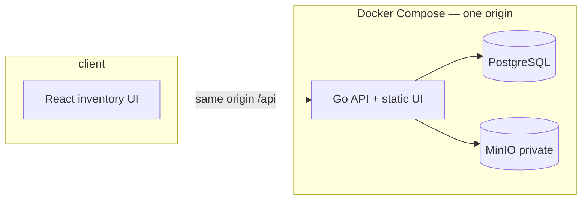
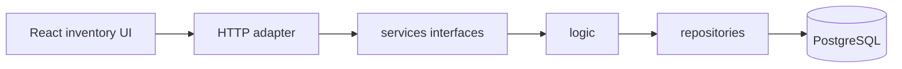

# Architecture

Dealership inventory dashboard: one Go API and a React screen. Managers filter vehicles, see aging stock, and record a proposed action.

**Words:** [GLOSSARY.md](../../GLOSSARY.md) · **Decisions:** [docs/adr/](../adr/) · **Behavior:** [.scratch/inventory-dashboard/spec.md](../../.scratch/inventory-dashboard/spec.md)

The API serves `/api` and the built screen on one port. MinIO is not published. The browser loads a primary image through the API ([ADR-0008](../adr/0008-api-streams-images.md), [ADR-0009](../adr/0009-one-origin-under-api.md)).

## Modules

Adapters, logic, and repositories. `internal/services` is only the interface the adapter calls and the logic implements.

| Layer | Package | Owns |
|-------|---------|------|
| Adapter | `backend/api` now. Events and third-party clients join it later | Bind the request, map the envelope. No inventory rules |
| Services | `internal/services` | Interfaces for each feature. No implementation and no SQL |
| Logic | `internal/logic` | Feature rules. Implements the service interfaces |
| Repository | `internal/repositories` | Queries and commands against PostgreSQL |

`internal/app/server.go` constructs repositories, constructs logic, and passes that logic to the HTTP adapter as the service interfaces.

| Module | Owns |
|--------|------|
| Catalog | Seeded makes and models. A model belongs to one make |
| Vehicle | VIN, model, entered on, stocked-out on, proposed action, inventory age, stock state, aging stock |
| Media | Optional primary-image key and the MinIO object |
| HTTP shell | REST envelope and the static React build |

## Where to read the rule

| Question | Doc |
|----------|-----|
| What a word means | [GLOSSARY.md](../../GLOSSARY.md) |
| Why a hard choice was made | [docs/adr/](../adr/) |
| Tables and indexes | [database-schema.md](database-schema.md) |
| Routes, bodies, errors | [api-outline.md](api-outline.md) |
| Packages | [directory-structure.md](directory-structure.md) |
| How the UI is wired | [frontend-integration.md](frontend-integration.md), [frontend-backend-mapping.md](frontend-backend-mapping.md), [inventory-frontend.md](inventory-frontend.md) |

## Workflows

1. **Scan** — open the dashboard, filter by make, model, stock state, or aging stock, page the list.
2. **Record or correct** — create an in-stock vehicle, or correct VIN, model, and entered on while it is in stock.
3. **Act on aging stock** — set, replace, or clear a proposed action. Only aging stock accepts that command.
4. **Stock out** — record stocked-out on. The row stays, aging stops, and a later call only corrects that date.
5. **Picture** — attach, replace, or remove one primary image while in stock. A missing image is a placeholder.
