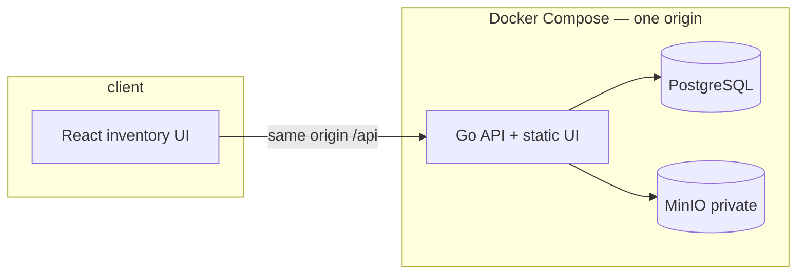
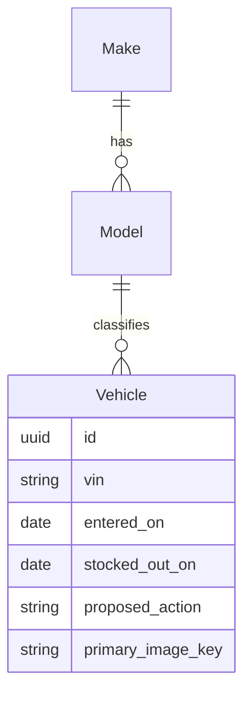

# Architecture Overview

Modular monolith for a dealership **inventory dashboard**: managers filter vehicles, spot **aging stock** (in stock more than 90 days), and record a **proposed action**. Scope stays appropriate for a senior assessment — no microservices, queues, or multi-tenant SaaS.

**Language:** [GLOSSARY.md](../../GLOSSARY.md)  
**Decisions:** [docs/adr/](../adr/)  
**Cursor rules:** [`.cursor/rules/`](../../.cursor/rules/)

## System context

Compose runs Postgres, MinIO, and the API. The API serves `/api` and the built screen on one port. MinIO is not published; the browser loads primary images through the API ([ADR-0009](../adr/0009-one-origin-under-api.md), [ADR-0008](../adr/0008-api-streams-images.md)).

## Module map

| Module | Responsibility | Primary tables / store |
|--------|----------------|------------------------|
| Catalog | Seeded makes and models; model belongs to one make | `makes`, `models` |
| Vehicle | VIN, model, entered on, stocked-out on, proposed action | `vehicles` |
| Aging | Inventory age and aging-stock flag (domain rule) | derived in logic |
| Media | Optional primary image object key + MinIO bytes | `vehicles.primary_image_key`, MinIO |
| API / UI shell | REST envelope + static React build | — |

Dependencies flow **inward**: handlers → application services (`logic`) → repositories. Cross-module calls go through service interfaces.

---

## 1. Domain model

### Aggregates and boundaries

- **Make** — manufacturer in the catalog (seeded).
- **Model** — vehicle line; belongs to exactly one make; referenced by vehicles ([ADR-0002](../adr/0002-model-catalog.md)).
- **Vehicle** — one physical car; opaque UUID identity; unique VIN; optional primary image; optional proposed action.

### Value objects and derived fields

| Concept | Rule |
|---------|------|
| Stock state | In stock when `stocked_out_on` is empty; stocked out when set ([ADR-0005](../adr/0005-stock-state-from-stocked-out-on.md)) |
| Inventory age | Calendar days from `entered_on`; stops on `stocked_out_on` when set |
| Aging stock | In stock **and** inventory age **> 90** days |
| Proposed action | `price_reduction_planned` \| `wholesale_planned` \| `hold` (optional; replace-in-place) |
| Primary image | Optional; Postgres key + MinIO object ([ADR-0003](../adr/0003-primary-image-in-minio.md)) |

### Domain rules (invariants)

| Rule | Enforcement | ADR |
|------|-------------|-----|
| Retain vehicles after departure | No delete-on-stock-out | [0001](../adr/0001-retain-stocked-out-vehicles.md) |
| Catalog make/model only | FK `model_id`; no free-text pair | [0002](../adr/0002-model-catalog.md) |
| Stocked out is terminal | Cannot return to in stock; VIN not reused | [0004](../adr/0004-stocked-out-is-terminal.md) |
| Stock state from date | No divergent status column | [0005](../adr/0005-stock-state-from-stocked-out-on.md) |
| Stable URL identity | UUID in path; VIN correctable while in stock | [0006](../adr/0006-uuid-vehicle-identity.md) |
| Separate commands | Stock-out, proposed action, image ≠ one PATCH | [0007](../adr/0007-separate-commands.md) |
| Images via API | Stream bytes; JSON has `has_primary_image` | [0008](../adr/0008-api-streams-images.md) |

### Entity relationship (conceptual)

---

## 2. Database schema

PostgreSQL is the source of truth. See [database-schema.md](database-schema.md).

**ID strategy:** UUID for `vehicles.id`.  
**Media:** private MinIO; API Head/Put/Get/Delete against the bucket; browser never talks to MinIO.

---

## 3. API structure

REST under `/api/v1`. Envelope `{ code, message, data, meta }`. See [api-outline.md](api-outline.md).

Design endpoints around manager workflows:

- One primary list GET with filters (make, model, aging / stock state).
- Mutations as separate commands where rules differ (stock-out, proposed action, image).

---

## 4. Frontend application structure

React + TypeScript SPA built into the API image for local Compose. See [directory-structure.md](directory-structure.md), [inventory-frontend.md](inventory-frontend.md), [frontend-integration.md](frontend-integration.md), [frontend-backend-mapping.md](frontend-backend-mapping.md).

### State

- **Server state:** TanStack Query — vehicle list, catalog options, mutations for commands.
- **Auth:** assessment-simple (none or basic) — document the chosen approach in an ADR if non-obvious; do not invent multi-tenant RBAC.

### UX anchors (from brief)

1. View and filter by make, model, and inventory age.
2. Automatically identify aging stock (> 90 days, in stock).
3. Record proposed action on aging vehicles.
4. Clear visual distinction between normal and aging stock.
5. Optional primary image with placeholder when missing.

---

## 5. Main user workflows

### Manager: scan inventory

1. Open dashboard (same origin).
2. Filter by make / model / aging-only.
3. Scan list: aging rows highlighted; optional thumbnail from `/api/.../primary-image`.

### Manager: act on aging stock

1. Select an aging vehicle.
2. Set proposed action (`price_reduction_planned` | `wholesale_planned` | `hold`).
3. Later choice replaces the previous one.

### Manager: stock out

1. Record stocked-out on (calendar day).
2. Vehicle remains listed as stocked out; no longer aging stock.
3. VIN cannot be added again; only stocked-out-on correction while stocked out.

### Manager: correct in-stock vehicle

1. PATCH allowed fields (e.g. VIN correction, entered-on if product allows) while in stock.
2. Upload/replace/remove primary image via image commands.

---

## 6. Error handling strategy

Typed errors mapped to the envelope with `error_code` in `data`:

| Code | HTTP | When |
|------|------|------|
| `VALIDATION_ERROR` | 400 | Bad dates, enums, body |
| `NOT_FOUND` | 404 | Unknown vehicle id |
| `CONFLICT` | 409 | Duplicate VIN; illegal transition (e.g. reopen) |
| `INTERNAL_ERROR` | 500 | Unexpected |

---

## 7. Testing strategy

See [.cursor/rules/testing.mdc](../../.cursor/rules/testing.mdc).

Critical scenarios:

- Inventory age day boundaries; aging requires in stock and age > 90.
- Stock-out terminal + VIN uniqueness.
- Separate commands reject mixed illegal updates.
- Image GET without key → 404 or placeholder policy (pick one and test it).

---

## 8. Security & Compose (assessment)

- MinIO credentials only inside the compose network.
- Single origin avoids CORS complexity ([ADR-0009](../adr/0009-one-origin-under-api.md)).
- Validate all DTOs; cap list `page_size`.
- Production hardening (TLS, real auth) is out of scope unless the assessment asks for it — state that explicitly in the README.

---

## Related docs

| Doc | Role |
|-----|------|
| [directory-structure.md](directory-structure.md) | Repo / package layout |
| [database-schema.md](database-schema.md) | Tables and indexes |
| [api-outline.md](api-outline.md) | Endpoint catalog |
| [frontend-integration.md](frontend-integration.md) | FE-first integration policy |
| [frontend-backend-mapping.md](frontend-backend-mapping.md) | Page ↔ API ↔ hook |
| [inventory-frontend.md](inventory-frontend.md) | UI stack and routes |
